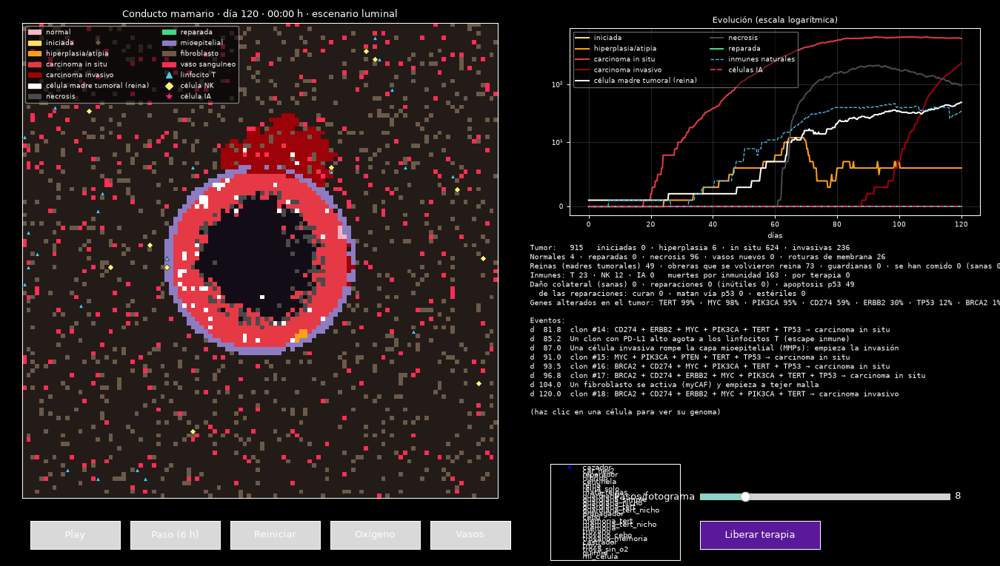
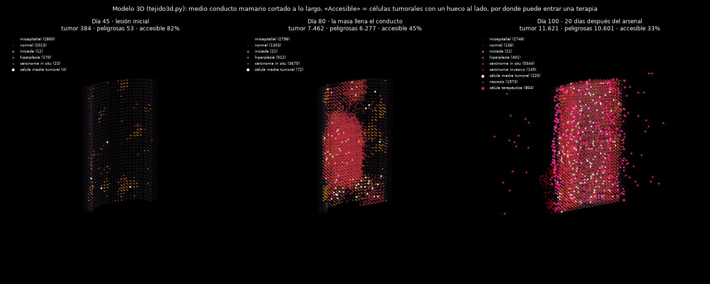
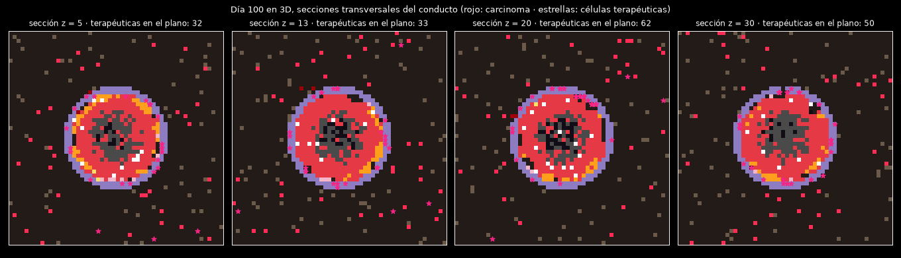

# Simulador de cáncer de mama y células terapéuticas programables

[](https://github.com/TheIsmael12/breast-cancer-abm/actions/workflows/ci.yml) [](LICENSE)

> **Proyecto abierto de investigación (licencia MIT).** Modelo por agentes, educativo y
> exploratorio. **No sirve para decisiones médicas**: las tasas están aceleradas y el
> tejido es un corte 2D de 1,65 mm. Lo que sí aporta es un banco de pruebas donde cada
> idea se mide con varias semillas, con criterios escritos antes de ejecutar y con los
> errores propios documentados.

> **Hecho con IA, y dicho claramente.** Este proyecto lo desarrolla **Claude** (modelo
> Opus de [Anthropic](https://www.anthropic.com), a través de Claude Code): el código, la
> búsqueda y lectura de literatura, el diseño y la ejecución de los experimentos, el
> análisis y la documentación. Lo **dirige Ismael Ben**, que no es biólogo ni médico:
> plantea las preguntas y las ideas que han marcado el rumbo (atacar a las células madre
> tumorales, reconducir el oxígeno en vez de cortarlo, no usar quimioterapia, buscar
> cómo no operar) y decide en cada bifurcación. Precisamente por eso la revisión de
> personas expertas es tan valiosa: si ves un error biológico, [dilo](CONTRIBUTING.md).

| | |
|---|---|
| **Último avance** | [2026-11-05 · ¿Se puede tratar sin operar?](docs/avances/2026-11-05-tratar-sin-operar.md): ctDNA mensual + ablación guiada controla 24/24 pacientes simuladas destruyendo 8 células sanas frente a 324 de la cirugía |
| **Todos los avances** | [`docs/avances/`](docs/avances/) |
| **Bitácora completa** (hallazgos, errores, expectativas fallidas) | [`docs/BITACORA.md`](docs/BITACORA.md) |
| **Informes técnicos** | [`docs/informes/`](docs/informes/) |
| **Capturas** | [`docs/capturas/`](docs/capturas/) (se regeneran con `python capturas.py`) |
| **Salidas brutas de cada experimento** | [`resultados/`](resultados/) |
| **Batería de validación contra la clínica** | `python validacion.py` |



**En 3D** (`tejido3d.py`) se ve el muro que frena a casi todas las terapias: las células
terapéuticas (estrellas) se quedan en la superficie y el núcleo es inaccesible. La
fracción accesible del tumor cae del 82 % al 33 % al crecer.




## Estructura del repositorio

```
├── main.py, visor.py            visor interactivo (Play, O₂, clic en una célula)
├── tejido.py, tejido3d.py       motor de la simulación (2D y 3D)
├── biologia.py                  genes, escenarios, parámetros y calibraciones
├── agentes.py, politicas.py     inmunidad y células terapéuticas programables
├── validacion.py                tests T1-T18 contra datos clínicos
├── tests/                       prueba de humo que pasa la CI en cada PR
├── sin_cirugia.py, prueba_residuo.py, capturas.py   estudio 2026-11-05
├── *.py                         un banco de pruebas por pregunta (tabla «Los programas»)
├── datos/                       TCGA-BRCA descargado de cBioPortal
├── resultados/AAAA-MM-DD/       salidas brutas de cada estudio
├── .github/                     CI, plantillas de issues y de PR
└── docs/
    ├── avances/                 un documento por avance, con fuentes y limitaciones
    ├── informes/                informes técnicos y hoja de ruta
    ├── capturas/                imágenes generadas por capturas.py
    └── BITACORA.md              registro cronológico completo
```

## Cómo contribuir o citar

Se aceptan *issues* y *pull requests*, sobre todo de personas con formación en biología
o en oncología: correcciones de supuestos, datos mejores o nuevos tests de validación.
Hay plantillas para cada caso y la CI comprueba cada PR (lint + prueba de humo).

- **Guía:** [`CONTRIBUTING.md`](CONTRIBUTING.md) · **Código de conducta:** [`CODE_OF_CONDUCT.md`](CODE_OF_CONDUCT.md)
- **Debate abierto:** [Discussions](https://github.com/TheIsmael12/breast-cancer-abm/discussions)
- La norma de la casa: **el criterio de éxito se escribe antes de ejecutar**, y un
  resultado que contradice la expectativa se publica igual.
- Para citarlo: [`CITATION.cff`](CITATION.cff).

---

Simulación por agentes (*agent-based model*) de un corte de un conducto mamario.
Le das a **Play** y ves cómo una célula acumula errores genéticos, escapa del
sistema inmune, llena el conducto, se queda sin oxígeno, rompe la membrana e
invade. Después sueltas células "inteligentes" programadas por ti para atacar o
**reparar el error**, y comparas estrategias.

```bash
pip install -r requirements.txt
python main.py                                  # ER+ esporádico (el más frecuente)
python main.py --escenario brca1                # portadora de BRCA1
python main.py --escenario her2 --terapia hibrido --dia-terapia 150
python experimento.py --escenario brca1 --dia-terapia 10 --terapias ninguna centinela reparador
```

En la ventana: **Play/Pausa**, **Paso (6 h)**, **Reiniciar**, **Oxígeno** (mapa de O₂),
elige una terapia y pulsa **Liberar terapia**. Haz **clic en una célula** para ver su genoma.

## ¿Cuál es "el bug"? Lo que dice la ciencia

No hay un único error. El cáncer de mama es una **acumulación de errores** en
genes concretos dentro de una misma línea celular, seleccionada por evolución
darwiniana dentro del tejido:

1. **El origen es casi siempre la célula luminal** del conducto o del lobulillo.
2. **Cada división copia 6.000 millones de letras** de ADN y comete algún error.
   La mayoría son inofensivos (mutaciones *pasajeras*); unos pocos caen en genes
   que controlan el crecimiento (mutaciones *driver*). Por eso el riesgo sube con
   la edad y con todo lo que hace dividirse más al epitelio, como los **estrógenos**.
3. **Oncogenes** (acelerador pisado): un golpe basta. PIK3CA (~35 % de tumores),
   amplificación de ERBB2/HER2 (~15-20 %), MYC.
4. **Supresores** (freno roto): hacen falta dos golpes, uno en cada copia
   (hipótesis de Knudson). TP53 (~30-35 %, ~80 % en triple negativo), PTEN, CDH1.
5. **Reparadores del ADN**: BRCA1/BRCA2. Quien hereda una copia rota (riesgo
   acumulado del 60-72 % a los 80 años) solo necesita un golpe más; a partir de
   ahí la célula muta unas 10 veces más rápido.
6. **p53 es el corrector de errores del organismo**: si detecta daño, manda
   suicidarse a la célula (apoptosis). Por eso casi todos los tumores BRCA1
   pierden TP53: sin desactivar al guardián, la inestabilidad los mataría.
7. **El sistema inmune también corrige**: los linfocitos T ven neoantígenos a
   través de MHC-I y las NK matan lo que esconde MHC-I. El tumor que sobrevive
   es el que pierde HLA o enciende PD-L1 (*inmunoedición*).
8. **Progresión**: hiperplasia → atipia → carcinoma **in situ** (llena el conducto,
   el centro se queda sin oxígeno y se necrosa) → rotura de la capa mioepitelial
   y la membrana basal → carcinoma **invasivo** → angiogénesis.

Todo esto **emerge** en la simulación sin estar programado como guion: nadie le
dice al tumor que pierda TP53 o HLA; los clones que lo hacen simplemente ganan.

## EL HALLAZGO: el problema no es el tumor, es el tejido

**Borrar el 100 % del tumor no cura.** Lo medimos con una sonda que no existe ni puede
existir: eliminar instantáneamente células tumorales sin tocar una sola célula sana, sin
margen, sin cirugía. Lo que ninguna terapia real puede conseguir.

| se deja del tumor | peligrosas a 400 días |
|---|---|
| 100 % (control) | 10.411 |
| 50 % | 10.388 |
| 20 % | 10.411 |
| 10 % | 10.422 |
| 5 % | 10.380 |
| 1 % (8 células) | 10.413 |
| **0 % (erradicación total)** | **4 de 5 semillas lo regeneran** |

**No hay umbral.** Dejar 8 células da el mismo resultado que dejar 740. Y con cero células
—verificado: cero tumorales inmediatamente después de la sonda— el tumor **vuelve a
aparecer**.

Tres comprobaciones descartan que sea un fallo de la sonda:

1. **Borra de verdad**: 0 tumorales tras la sonda, en 5 de 5 semillas.
2. **La reaparición es lenta, no es expansión de un residuo**: 4-6 células al día 150,
   ~1.300 al día 300. El tumor original tardó 120 días en llegar a 740; el regenerado
   tarda ~180 en llegar a 1.300. **Velocidad comparable → carcinogénesis de novo.**
3. **Hay rastro del campo**: las mutaciones acumuladas en las células **sanas** suben de
   0,0 a 0,4-0,7. El tejido que queda no es el que había al principio: está premutado.

Y una coherencia interna que nadie programó: **la semilla 5 es la única con 0,0 mutaciones
en sanas y la única que no reincide.**

Esto es **cancerización de campo** (Slaughter, 1953). Borras el producto y dejas la
fábrica.

### Por qué eso explica todos los fracasos de este proyecto

| se intentó | resultado | por qué fallaba |
|---|---|---|
| reparar el gen malo | 3 vías, todas iguales o peores | se arreglaban células, no el tejido |
| que se lo coman las buenas | ×7 fagocitosis, cero efecto | se limpiaba el producto |
| hacer visibles las reinas | +25 % de muertes, cero efecto | mejor puntería sobre el objeto equivocado |
| matar la reina | se rehace desde las obreras | la fuente no era la fuente |
| cerrar el grifo de la hipoxia | mecanismo sí (5/7), desenlace no | grifo secundario |
| **vaciar el 100 %** | **regenera** | la fábrica seguía entera |

Y explica lo que el cementerio ya decía: por qué las recurrencias en mama se reparten
entre los años 5 y 20, y por qué **lo único con efecto demostrado a 15 años es el
tamoxifeno** — el único agente que no mata células, sino que **apaga la señal del tejido**.

### Límite conocido: esto sirve para TRATAR, no para PREVENIR

Probado el 2026-10-22 con **tejido virgen** (sin célula sembrada), 8 semillas, 700 días:

| | incidencia | día de aparición | carga final |
|---|---|---|---|
| campo normal (estrógeno 0,6) | **8/8** | 107 | 10.474 |
| campo apagado (0,1) | **8/8** | 151 | 10.478 |

**Cero reducción de incidencia y cero de carga final.** El retraso ni siquiera es
consistente: 6 semillas retrasan y **2 adelantan**.

Dos fallos frente a la realidad, y los dos tienen la misma causa:

1. **El tejido virgen desarrolla cáncer en el 100 % de los casos.** El riesgo real a lo
   largo de la vida ronda el 12 %.
2. **Apagar el campo no previene**, cuando el tamoxifeno en prevención primaria reduce la
   incidencia alrededor del 50 %.

La causa es que **las tasas de mutación están aceleradas** para que pase algo en una
ventana de simulación corta. Eso es razonable para estudiar tratamiento e **invalida el
modelo para estudiar prevención**: si cada célula muta lo bastante rápido, cualquier tejido
acaba produciendo un tumor hagas lo que hagas. No se arregla tocando el estrógeno; habría
que recalibrar la tasa de mutación contra la incidencia real.

Queda como **T14** en `validacion.py`, fallando a la vista, para que el límite no se
olvide. De las tres propiedades reales de la hormonoterapia, el modelo reproduce dos
(inútil en solitario, el riesgo vuelve al retirarla) y **falla la tercera**.

## La estrategia que queda: tres capas

| capa | contra qué | cuándo | ¿existe? |
|---|---|---|---|
| 1. **vaciar** | el tumor existente | puntual | CAR-T + vehículo (CAR-M) |
| 2. **cerrar el grifo** | la fábrica de reinas (hipoxia ×3) | puntual | normalización vascular |
| 3. **apagar el campo** | que vuelva a empezar | **mantenido** | tamoxifeno / IA |

**Resultados, 20 semillas (13 nunca usadas para decidir nada):**

| | colapsos (<100) | intermedios | fracasos (>8.000) | desviación |
|---|---|---|---|---|
| vaciar + grifo | **12/20** | 3 | **5** | 4.242 |
| + campo (3 capas) | **12/20** | 6 | **2** | 3.408 |

**El número del proyecto: vaciar + cerrar el grifo controla el tumor en 12 de 20 semillas
(60 %)**, con validación fuera de muestra.

Añadir el campo **no mejora los casos buenos** (12 contra 12) pero **recorta la cola mala**
(fracasos de 5 a 2). Con la métrica corregida: gana 5, pierde 3, empata 12. **No es una
prueba** —con n=20, 5 contra 3 es una tendencia— pero es consistente con un mecanismo que
entendemos.

Y dos cosas sobre la capa 3 que el modelo reprodujo sin que se le enseñaran:

- **Sola no sirve**: 10.394 frente a 10.400 sin tratar. Es *adyuvante*, como el tamoxifeno
  real: se da después de vaciar, nunca en lugar de.
- **Retirarla devuelve el riesgo**: de 6.087 a 9.674 (5 de 7 semillas). El tamoxifeno exige
  cinco años de toma continua por el mismo motivo.

## AVISO: este README se reescribió el 2026-10-21

Dos reescrituras seguidas, por dos motivos distintos:

- **2026-10-20**: las tablas estaban medidas en un modelo **sin barrera física**. Al añadir
  la presión intersticial y la malla desmoplásica, buena parte dejó de sostenerse.
  Detalle en `docs/informes/INFORME_BARRERA.md`.
- **2026-10-21**: el proyecto se llamaba "células terapéuticas programables" porque la idea
  era **curar la célula madre tumoral y reprogramarla**. Ese brazo se ha medido a fondo y
  **no funciona** — ver *Curar reprogramando: acta de defunción*. Lo que sostiene el
  simulador ahora es **matar y cerrar la fuente**, que es otra cosa y tiene otras piezas
  reales detrás.

El nombre del proyecto se ha quedado antiguo a propósito: se deja como estaba para que
quede constancia de por dónde empezó la idea y por qué cambió.

## Lo primero: por qué desconfiar de este simulador

Es un modelo educativo escrito a mano. Cuando "descubre" algo, está desplegando las
suposiciones de quien lo escribió, no descubriendo biología. Ejemplo real de esta casa:
el modelo reprodujo el fracaso clínico de eliminar los CAFs... porque dos horas antes se
había programado `contencion_matriz = 0.8`. No fue un hallazgo, fue un eco.

La regla que vale: **un resultado solo cuenta si sobrevive a cambiar la suposición que lo
produce.** De ahí los barridos de sensibilidad (`reversion.py`, `--plasticidad`).

Y un aviso de método que costó un día entero: **la varianza entre semillas domina al
tratamiento.** La misma configuración da 976 o 10.487 peligrosas. Ninguna media de 3
semillas significa nada; hay que mirar medianas y las semillas una a una.

## Las tres barreras de un tumor sólido

No hay ninguna membrana que envuelva el tumor. Lo que impide entrar son tres cosas
distintas, y confundirlas lleva a atacar la equivocada:

| Barrera | Qué es | Cómo se levanta |
|---|---|---|
| Geometría | una esfera esconde su interior (accesible ∝ 1/r) | no se arregla con fármacos |
| Presión intersticial | vasos porosos + linfáticos colapsados: el líquido empuja hacia fuera | degradar matriz, normalizar vasos |
| Oxígeno | difunde ~100-150 µm desde un capilar: el centro está lejos | acercar vasos ("reconducir") |

La presión es **corriente en contra**, no una pared: en el modelo solo frena a quien
intenta ENTRAR (`Simulacion._frena_la_presion`); salir es gratis.

**El número que lo decide.** Mismo tumor, mismo anti-CD47, misma biología:

| presión | células con "cómeme" | fagocitadas | pasos bloqueados |
|---|---|---|---|
| 1,0 (real) | 621 | **3** | 17.139 |
| 0,0 (irreal) | 559 | **920** | 0 |

×300. La señal estaba puesta en 620 células todo el tiempo. Lo que fallaba era llegar.

## La malla: quién la teje y por qué no hay que romperla

Los **myCAF** (fibroblastos activados por el TGF-β del tumor) fabrican colágeno I y ácido
hialurónico. El HA es un gel que retiene agua: de ahí sale la presión. La **LOX**
entrecruza el colágeno y lo tensa. Y hay un bucle que la mantiene sola: la rigidez que
fabrica el CAF activa más CAFs por mecanotransducción (YAP/TAZ, Calvo 2013).

`tratar_matriz()` separa las cinco formas de atacarla, porque **no son equivalentes**:

```bash
python malla.py --semillas 3   # hialuronidasa · anti_lox · losartan · anti_tgfb · matar_caf
```

| intervención | peligrosas | invasivas | fagocitosis |
|---|---|---|---|
| ninguna | 10.387 | 8.701 | 0 |
| `matar_caf` | **10.856** | 9.117 | 0 |
| `anti_lox` | 10.356 | 8.631 | 0 |

**Ninguna abre el acceso.** Y matar los CAFs sale peor que no hacer nada, porque la malla
también **contiene** al tumor. Coincide con la clínica: PEGPH20 falló en fase III y empeoró
la supervivencia; eliminar CAFs empeoró los tumores en ratones (Özdemir 2014; Rhim 2014).

En 3D, degradar media matriz no movió nada: 26 % accesible y 1 % de núcleo alcanzado antes
y después. Ese 26 % es **geometría pura**, no presión.

## Lo que sí funciona: entrar invitado

El tumor recluta monocitos activamente (CCL2) y les abre el endotelio. Un vehículo así no
nada contra la corriente: **lo llevan**. Al verse rodeado de tumor, suelta la carga dentro.
Real: CAR-M en ensayo clínico, células madre mesenquimales como vehículo.
Ver `troyano`, `troya` y `castrador` en `politicas.py`.

| estrategia | peligrosas | reinas | por semilla |
|---|---|---|---|
| nada | 7.637 | 1.896 | 2.122 · 10.377 · 10.413 |
| `guardiana_nicho+memoria` | 6.932 | 1.540 | 10 · 10.376 · 10.410 |
| **`troyano+guardiana_nicho+memoria`** (dosis 300) | **6.651** | **826** | **3 · 9.922 · 10.029** |

El vehículo **reduce las reinas a la mitad** y es lo único que ha movido las semillas
grandes. La dosis importa y satura: 40 → 940 peligrosas, 120 → 9, 300 → 5.

## Tres cosas que parecían buena idea y no lo son

**1. Castrar (esterilizar en vez de matar) enriquece el tumor en reinas.**

| | peligrosas | reinas | castradas |
|---|---|---|---|
| nada | 7.637 | 1.896 | 0 |
| con castradores | 7.053 | **2.301** | 588 |
| sin castradores | 6.651 | **826** | 0 |

Durante tres sesiones se explicó así: *si esterilizas a las que se dividen, sobreviven las
quiescentes*. **Esa explicación era incompleta.** El mecanismo real, medido después, es
que las células que jubilas se vuelven senescentes, y una senescente empuja a su vecina a
desdiferenciarse en reina (SASP). Cortando el SASP, las reinas del brazo castrador bajan a
la mitad en 5 de 5 semillas — ver *Matar y cerrar*. Sigue siendo el mismo fenómeno que
enriquece el tumor en células madre tras la quimioterapia, pero ahora con una palanca
encima.

**2. La bombona de oxígeno no aporta nada.** 7.058 sin O₂ frente a 7.053 con O₂. Ruido.

**3. La "guardiana" no hace el trabajo.** Esto corrige dos días de interpretación propia:

```
guardianas creadas en 450 días .... 23
vivas al final ..................... 1
células que fagocitan .............. 5     (de 10.029 peligrosas)

muertes por ataque directo .... 82.102
reparaciones génicas ........... 3.520
```

El mecanismo que da nombre a la estrategia se come **cinco células**. Lo que funciona es
matar y editar. Por eso `reversion.py` salió plano: da igual que el estado reprogramado
dure para siempre o cinco días, porque el estado es irrelevante.

## Curar reprogramando: acta de defunción

El brazo central del proyecto —arreglar el gen malo para que la célula vuelva a ser
buena— se ha atacado por tres caminos independientes. Los tres fallan, y **por la misma
razón**.

**Primero hubo que medir.** El contador `reparaciones` mezclaba tres mecanismos distintos
y escondía en qué acababa cada edición. Separado (`reparaciones_que_curan` /
`_p53_letales` / `_esteriles`):

```
reparaciones estériles (gen corregido, sigue tumoral) .... 91,2 %
reparaciones que curan (n_drivers == 0) ...................  8,3 %
reparaciones que matan vía p53 ............................  0,5 %
cargas gastadas en genes que ya estaban sanos ............. 1.738   (8× las efectivas)
```

Nueve de cada diez ediciones no sirven para nada. Y la que más se parece a la realidad no
es la que cura, es la que mata: restaurar TP53 dispara apoptosis (es el mecanismo de
Ventura y Xue, *Nature* 2007).

**Después apareció un fallo de diseño propio.** `TERT` cuenta como driver pero no estaba
en los vectores de reparación, así que el **91,5 % de las reinas era incurable por
construcción**: nunca podía llegar a `n_drivers == 0`. Las 23 guardianas de arriba eran
exactamente el ~9 % restante. Corregido:

| | reparaciones | curan | guardianas | peligrosas (por semilla) |
|---|---|---|---|---|
| sin TERT | 212 | 20 | 20 | 326 · 1 · 145 · 374 · 1.111 |
| con TERT | 196 | **53** | **53** | 273 · 1 · 261 · 451 · **2.100** |

Las guardianas se multiplican por 2,65 y **el tumor sale igual o peor**: empeora en 3 de 5
semillas y casi duplica en la grande.

**Por último se le dio el mecanismo más potente del repertorio**, el efecto espectador de
la corrección (`propagacion_correccion`): una célula corregida corrige a sus vecinas, y
éstas a las suyas. Coste que no crece con el número de células.

| brazo | propagadas | corregidas del todo | peligrosas (semilla grande) |
|---|---|---|---|
| apagado | 0 | 0 | 1.111 |
| prop .05 alcance 4 | 110 | 84 | 2.839 |
| prop .20 alcance 4 | 170 | 110 | 2.471 |
| prop .50 alcance 8 | 266 | 125 | **3.070** |
| prop .50 alcance 8 + 5 % error | 274 | 111 | 3.057 |

Propaga de verdad (125 células corregidas por completo) pero **no es exponencial**:
multiplicar la probabilidad por 10 y el alcance por 2 sólo lleva de 110 a 266
propagaciones. La cadena se ahoga porque corrige un alelo por intento y cada corregida
queda rodeada de tumorales que se dividen más rápido. Y en el tumor grande **empeora en 4
de 4 brazos**, entre 2,2× y 2,8×.

### La causa común

Las tres vías comparten el mismo mecanismo, y está en el código: convertir una tumoral en
"curada" la **saca de la lista de dianas**, pero la célula conserva la aneuploidía
(`tejido.py:398`) y puede volver a mutar sin ninguna protección. Estamos fabricando
células que nadie vigila y que se rompen otra vez. Cuanto más grande el tumor, más caro
sale.

Encaja incómodamente bien con el mejor dato humano que existe: **rezatapopt**, que
reactiva p53 Y220C (ensayo PYNNACLE, fase 2, corte de agosto de 2025) da **33 % de
respuestas, 6,2 meses de duración mediana, y 18 % en mama**. Respuestas y meses, no
curaciones — y la resistencia vuelve por drivers alternativos generados por inestabilidad
cromosómica, que es exactamente la aneuploidía que nuestras células "curadas" conservan.

**La consecuencia es buena**: la estrategia que queda no depende de la pieza inventada
(reprogramar una célula madre tumoral como guardiana, que no existe en ningún
laboratorio). Depende de células terapéuticas persistentes que **matan** (CAR-T) y de
cerrar la fuente.

## Matar y cerrar: la fuente tiene tres grifos

Si la cura no viene de reparar, viene de matar. Pero matar sin cerrar la fuente ya sabemos
que no basta. En el modelo la fuente de reinas tiene **tres grifos**, y cada uno tiene su
llave (`tejido.py:262-278`):

| grifo | cómo se cierra | ¿existe en la realidad? |
|---|---|---|
| reinas que se dividen | matándolas | sí — CAR-T persistentes |
| plasticidad, **×3 con hipoxia** | oxigenando (`reconducir`) | sí — normalización vascular |
| **SASP**: una senescente empuja a su vecina a desdiferenciarse | `farmaco_anti_sasp` | sí — inhibidores JAK (ruxolitinib) |

**El SASP explica por fin el enriquecimiento en reinas.** Es un efecto condicional, y por
eso costó verlo: en el brazo que mata hay 18 senescentes y el término no se activa ni una
vez (resultado idéntico dígito a dígito). En el brazo que castra hay 132 y domina:

| | desdiferenciaciones | senescentes | reinas |
|---|---|---|---|
| castrar | 900 | 132 | 875 |
| castrar + anti-SASP | **431** | 79 | **407** |
| matar (referencia) | 289 | 13 | 218 |

Las reinas bajan a la mitad **en 5 de 5 semillas**. O sea: las células que jubilas gritan,
y el grito fabrica reinas nuevas. Es senescencia inducida por tratamiento, está descrita,
y tiene antídoto. Pero ojo: **las peligrosas no se mueven** (6.393 → 6.370). Entiendes el
mecanismo, lo neutralizas, y por sí solo no sirve de nada.

Dos controles que conviene no olvidar: **"solo cerrar" sin matar no controla nada**, y
emparejando bajas exactas, **matar no sale peor que castrar por dejar la celda libre** (la
hipótesis de que el hueco acelera la repoblación quedó falsada: 401 vs 400 bajas, 5.485
frente a 6.625 peligrosas, y por semilla es ruido).

### La bifurcación

A 500 días, añadir `reconducir` al brazo matador parte el resultado en dos:

```
solo matar:          9913 ·  1 · 8692 ·  5608 ·  9906 ·  9718 · 9996
matar + reconducir:    12 ·  1 · 8268 · 10392 · 10428 · 10270 ·    9
```

Parece que haya dos colapsos casi totales (9.913 → 12 y 9.996 → 9). **No los hay: es caos
determinista.** Se investigó a fondo y el resultado es el más instructivo del proyecto.

**La prueba**: misma semilla, mismo día, cambiando la dosis **en una sola célula**.

| semilla | dosis 299 | dosis 300 | dosis 301 |
|---|---|---|---|
| 1 | **10.102** | **12** | 9.725 |
| 7 | 7 | 9 | **659** |

Una célula terapéutica de más convierte 12 en 10.102. Y variando sólo el día de
intervención, el estado del tumor empeora **monótonamente** (más células, más reinas,
menos O₂) mientras el desenlace salta sin orden: d118 → 9.811, **d120 → 12**, d122 →
8.122. En el día 118 el tumor estaba *mejor* que en el 120 y acabó mil veces peor.

Eso demuestra que **ninguna función monótona de esas variables puede predecir el
desenlace**. No es que no hayamos encontrado el biomarcador: es que no puede existir.
Validación fuera de muestra (semillas 8-14): **cero rescates**; en 6 de 7 el tumor nunca
llegó a ser hipóxico y reconducir no hizo literalmente nada (trayectorias idénticas).

**Qué es `reconducir` en realidad**, con números: no es "quitar la hipoxia = bueno", es un
intercambio cuantificado.

| efecto | dónde | signo |
|---|---|---|
| ×6,7 velocidad de división | `tejido.py:321` (`pdiv *= 0.15` si hipóxica) | malo |
| ÷3 fabricación de reinas | `tejido.py:273` (plasticidad ×3 si hipóxica) | bueno |
| sin motivo para angiogénesis | `tejido.py:314` | bueno |

Las dos fuerzas son grandes y se deciden cerca de la frontera. Cerca de la frontera, el
sistema es caótico.

**La regla que deja**: en este simulador hay que reportar siempre distribuciones sobre
muchas semillas, y **nunca** presentar un 9.913 → 12 como efecto terapéutico. Es un
resultado honesto e interesante por sí mismo —sensibilidad a condiciones iniciales en un
modelo por agentes— pero es lo contrario de un hallazgo clínico.

### Lo que sí quedó en pie, y cambia la estrategia

**1. La enfermedad residual controlada es compartimento madre puro.** En los nueve finales
controlados, `peligrosas == reinas` exactamente (12=12, 9=9, 19=19, 4=4...). Lo que
sobrevive al tratamiento son reinas, y sólo reinas.

**2. Llegar a cero reinas NO es absorbente.** En una corrida el sistema estuvo **90 días
seguidos con cero reinas y cero peligrosas**, con ~90 obreras vivas, y se rehízo: las
desdiferenciaciones siguieron subiendo durante esa ventana (cada reina nueva nacía de una
obrera y la mataban, en equilibrio) hasta que una escapó.

Esto **invierte la estrategia del proyecto**. Durante tres días la idea fue *mata la
reina, que es la fuente*. Pero mientras quede una obrera, la plasticidad (`tejido.py:273`)
rehace la reina. El punto de no retorno, si existe, es **vaciar el depósito de obreras**,
no erradicar las reinas.

### Por qué hay respuesta y luego recaída

El simulador produce la curva clínica clásica sin que nadie se la programe:

```
día 120 (tratamiento) ....  673 peligrosas    28 desdiferenciaciones
día 200 ..................  298  ← mínimo    109
día 300 ..................  335               185
día 400 .................. 1290               367
día 500 .................. 8692               837
```

La causa está en la columna de al lado: **las desdiferenciaciones no paran nunca**.
Mientras el tratamiento mata, la fuente sigue fabricando reinas a ritmo creciente.

Y el momento del escape tiene explicación mecánica: la oleada terapéutica es **transitoria**
(el troyano vive 400 pasos, la guardiana 500; a partir del día ~340 sólo quedan los 300
agentes permanentes de `memoria`), y justo entonces el tumor **se arregla su propia hipoxia
construyendo vasos**. El O₂ medio sube *antes* del despegue: 0,236 → 0,275 → **0,430** →
0,49, y las peligrosas detrás: 324 → 335 → **672** → 1.606.

Es una carrera entre una oleada que se agota y un tumor que se repara. El problema no es
que matemos poco —el tumor baja a menos de la mitad— es que **no duramos**. Que es
exactamente el problema del campo real, donde las recurrencias en mama aparecen repartidas
entre los años 5 y 20 (EBCTCG, *NEJM* 2017, 62.923 mujeres).

## El techo: hasta qué tamaño funciona algo

Misma estrategia, 7 semillas, ordenadas por carga tumoral el día del tratamiento:

| tumor el día 250 | peligrosas al final | |
|---|---|---|
| 213 | 0 | ✔ |
| 471 | 5 | ✔ |
| 861 | 6.050 | ✘ |
| 917 | 2 | ✔ |
| 4.451 | 10.866 | ✘ |
| 7.256 | 10.935 | ✘ |
| 10.079 | 10.922 | ✘ |

**Por encima de ~4.000 células no funciona nada** (3 de 3). Se han probado ocho estrategias
distintas contra esas semillas y todas dan ~10.400. La diferencia entre curar y no curar
no fue el tratamiento: fue el tamaño del tumor el día que se empezó.

## Extirpar primero rompe el techo — y qué es en realidad esa cirugía

Cuando se levantó el veto a la cirugía (2026-10-22) apareció el mejor resultado del
proyecto. Protocolo: `resecar(0.95, 2)` el día 120 → `troyano+guardiana_nicho+memoria`
→ reconducir vasos. 8 semillas, 500 días:

| brazo | erradica | controlado | finales |
|---|---|---|---|
| inyectar SIN extirpar | 0/8 | 1/8 | 3.276 · 117 · 2.751 · 8.849 · 10.062 · 6.121 · 6.354 · 86 |
| **extirpar + inyectar** | **4/8** | 7/8 | pico 28 |
| protocolo completo | 4/8 | **8/8** | 16 · 0 · 42 · 28 · 0 · 0 · 22 · 0 |

La explicación sigue en pie: convierte un problema de **volumen** en uno de
**superficie**, y por eso la misma terapia que fracasaba contra 4.000 células funciona
contra un residuo de 0-15. Es el esquema clínico estándar de los últimos cien años
—cirugía primero, sistémico sobre el residuo después— que el simulador redescubrió solo.

**Pero la interpretación de aquel día estaba mal, y esto lo corrige (medido 2026-10-29,
`scratchpad cirugia/`, tres sondas que no miran el desenlace):**

| | medido |
|---|---|
| arco del anillo ductal ocupado por el tumor | **90 %**, en 5 componentes conexas |
| conducto extirpado por `resecar(0.95, 2)` a 400 células | **93 %** |
| conducto extirpado el día 120 (el protocolo de arriba) | **96 %** |
| censo del campo | 1.251 células = 188 luminales + 224 mioepiteliales + 839 fibroblastos |

Como el tumor **rodea** la luz, el centroide del disco cae en el centro del conducto y el
corte (radio ~28 celdas) engloba el conducto entero (radio 22). Así que `resecar()` **no
es una tumorectomía en ninguna configuración: es la resección completa del único órgano
del campo**. Y el precio que se anotó entonces —*«210 células sanas, ~1,7 % de un conducto
de ~12.000»*— comparaba células del modelo contra un conducto humano real: el conducto de
este simulador tiene **412 células**, y el epitelio luminal entero, **188**.

Dos cosas que esto invalida y una que no:

- ✘ No vale decir que el modelo «carece de multifocalidad». **La tiene**: 5 focos y el
  90 % del anillo. Añadir focos satélite habría sido añadir lo que ya estaba.
- ✘ No vale leer el éxito como «una cirugía conservadora basta». Lo que basta aquí es
  quitar el órgano entero.
- ✔ Sigue en pie que el tamaño del residuo es lo que decide, que es el hallazgo útil.

### El límite que esto deja escrito (T18)

El campo mide **1,65 mm** de lado y el conducto **330 µm** de radio. Un margen quirúrgico
clínico (1-2 mm, *no ink on tumor*) son 67-133 celdas: **más que el semilado del campo**.
Ninguna cirugía con margen realista cabe aquí, así que la tasa absoluta de recaída no es
contrastable. Lo que sí lo es: una **razón** entre dos brazos del propio modelo.

`T18` mide el peso del margen con 42 semillas nuevas y criterio escrito antes:

| margen tras `resecar(0.95, 2)` | n | recaída |
|---|---|---|
| **negativo** (residuo 0) | 23 | **0 %** |
| **positivo** (residuo > 0) | 19 | **32 %** |
| control de *de novo* (vaciado total) | 42 | 7 % |

RR = **∞** (15,6 con corrección de continuidad) frente al **2,44** de Houssami 2010 →
**falla**. En el modelo un margen negativo cura siempre; en la clínica no, porque queda
enfermedad en el resto de la mama. **Fuera del conducto no hay mama**: el campo tiene un
solo sistema ductal y la mama real tiene 15-20. El modelo no es aquí optimista ni
pesimista — **le falta el órgano**.

Lo que sí reprodujo sin que se le enseñara: el signo y la dosis-respuesta (residuo 0 →
0 %, residuo 31 → 57 %) y una tasa de márgenes positivos del 45 % frente al 20-25 %
clínico, el mismo orden de magnitud.

## Por qué fracasan las terapias reales (y nosotros igual)

- **82 %** de los fármacos oncológicos que fracasan en fase tardía es por **falta de
  eficacia**, no por toxicidad. El **62 %** de los ensayos de fase III no alcanza su objetivo.
- **Magrolimab** (anti-CD47, 4.900 M$): ENHANCE-3 parado por **aumento de mortalidad**.
- **PEGPH20** (hialuronidasa): fase III fallida, empeoró la supervivencia.
- **Nanopartículas**: **0,7 %** de la dosis llega al tumor, sin mejorar en diez años.
- **Terapia de diferenciación**: cura la leucemia promielocítica (ATRA + trióxido de
  arsénico, remisión completa del 100 % y supervivencia libre de eventos del 97 % a dos
  años) y **no ha curado ni un tumor sólido**.

Tres causas, y la tercera es la que este proyecto reproduce sin querer:

1. Cada terapia resolvió **una barrera de cinco** y perdió contra las otras cuatro.
2. El cáncer es un **proceso evolutivo**: toda presión única selecciona resistentes.
3. **Las terapias se validan en el régimen donde funcionan.** Los modelos preclínicos usan
   tumores pequeños y limpios; los pacientes de fase III, grandes y heterogéneos. El salto
   de ratón a humano es el salto de nuestra semilla pequeña a la grande.

## El cementerio: once barreras, dos resueltas

Detalle completo en **`docs/informes/INFORME_CEMENTERIO.md`**. Lo imprescindible:

De once barreras identificadas en tres décadas de ensayos, **sólo dos están resueltas**, y
las dos las resolvió la misma tecnología (ADC con payload permeable) por el mismo
mecanismo: derramar el citotóxico ~100 µm desde donde se unió. Brentuximab da respuestas en
**9 de 14 pacientes con la diana escasa o ausente**; T-DM1 en EMILIA produjo **menos**
efectos adversos graves que su comparador **con mejor eficacia**.

**Los ADC no resolvieron «llegar»**: entregan el 1-2 % de la dosis, el mismo orden que el
0,7 % de las nanopartículas que llamamos fracaso. Subieron la potencia del payload tres
órdenes de magnitud. Es una solución de **potencia**, no de **transporte** — distinción
crítica para un simulador que modela el transporte.

**La barrera que no ha resuelto nadie** es la conjunción de tres propiedades en la misma
célula: **lejos del vaso, quiescente, y en otro órgano**. Las tres covarían, y eso la hace
irreducible. Más del 80 % de las pacientes albergan sólo DTCs Ki67-negativas, y todo el
arsenal citotóxico presupone proliferación.

Y lo que nos toca de cerca: **atacar «la reina» ya se intentó y está muerto**. Notch, Wnt y
Hedgehog murieron porque la diana es compartida con la célula madre normal
(vantictumab e ipafricept: fracturas óseas). Es el mismo muro que encontró
`identificadores.py` por su cuenta.

## Las preguntas para un laboratorio

Ninguna la contesta un ordenador, y todas son baratas comparadas con lo demás:

1. **¿Con qué facilidad se desdiferencia una célula tumoral de mama in vivo?** Es lo único
   que hundió la estrategia en el análisis de sensibilidad (plasticidad ×10 → 312
   peligrosas frente a 2,7).
2. **¿El cuello de botella de las terapias celulares en tumores sólidos es reconocer la
   diana o llegar hasta ella?** Y si es llegar, ¿hasta qué carga tumoral sigue siendo
   reversible?
3. **¿Cuánta stemness fabrica el SASP de las células que un tratamiento deja senescentes,
   y la frena un inhibidor JAK?** Es la pregunta nueva de 2026-10-21, es la más barata de
   las tres, y tiene fármaco aprobado con el que probarlo.

## Lo que este simulador NO ha conseguido

Conviene tenerlo junto y en una lista, porque es más largo que la de los aciertos:

- **Curar reprogramando el gen malo.** Tres vías independientes, todas peores o iguales.
- **Que se lo coman las células buenas.** Techo doble; ×7 fagocitosis no mueve el tumor.
  Coincide con LION, CARMENA y GOG-0213, tres ensayos aleatorizados reales.
- **Abrir la malla.** Ninguna de las cinco intervenciones dio acceso; matar los CAFs sale
  peor que no hacer nada.
- **Curar un tumor grande.** Por encima de ~4.000 células el día del tratamiento, nada ha
  funcionado nunca (3 de 3, con ocho estrategias distintas).
- **Un predictor de quién responde.** La bifurcación de `reconducir` no se explica por
  nada medible el día de intervenir.

Lo que sí hay: un vehículo que entra (troyano), una puerta Y que no toca tejido sano
(0 sanas comidas en todos los brazos probados, incluido el de 4.665 fagocitosis), y un
mecanismo nuevo con antídoto real (SASP → stemness → inhibidores JAK).

## Los programas

| | qué hace |
|---|---|
| `main.py` | visor con Play, mapa de O₂, clic en una célula para ver su genoma |
| `experimento.py` | banco de pruebas sin ventana: compara terapias con varias semillas |
| `tejido3d.py` | versión 3D (cilindro, 26 vecinos). Sin malla: solo presión y geometría |
| `datos_reales.py` | contraste con ~1.000 pacientes reales de TCGA vía cBioPortal |
| `identificadores.py` | ¿qué marcador identifica al tumor y solo a él? → `docs/informes/INFORME_IDENTIFICADORES.md` |
| `puertas.py` | sensibilidad y especificidad de cada puerta lógica, como un test diagnóstico |
| `barrera.py` | acceso en 3D: geometría, presión y oxígeno por separado |
| `malla.py` | las cinco formas de atacar la malla: ¿abren el paso sin soltar al tumor? |
| `cadena.py` | la secuencia completa: abrir · desenmascarar · castrar · comer · cerrar la fuente |
| `reversion.py` | ¿cuánto tiene que durar un estado celular impuesto para que valga? |
| `propagacion.py` | corrección con efecto espectador: ¿cuánta fidelidad necesita la edición? |
| `sin_cirugia.py` | ¿se puede tratar sin operar? Cirugía, ablación, biopsia y ctDNA como puertas de decisión |
| `prueba_residuo.py` | ¿quién conserva tumor? Biopsia por vacío frente a ctDNA |
| `capturas.py` | regenera las imágenes de `docs/capturas/` sin abrir ventana |

## Programa tu propia célula

Edita `mi_celula.py` y elige **mi_celula** en la ventana. Reglas realistas:

- Tu célula **no lee el ADN**. Solo ve la superficie: MHC-I, neoantígenos, PD-L1,
  HER2, ligandos de estrés, proliferación (Ki-67), hipoxia, y siente quimiocinas.
- Para conocer el genoma debe **Analizar** (secuenciar), y eso cuesta un turno.
- **Reparar** solo funciona con los genes de sus `vectores`, gasta `carga` y falla
  el 40 % de las veces (eficacia realista de la edición génica, aún optimista).
- **Atacar** depende de sus `receptores`: `TCR` (necesita MHC-I y es frenado por
  PD-L1 salvo `resistente_pdl1`), `NK`, `HER2` (CAR-T) o `INESPECIFICO` (mata también sanas).

## Lo que este simulador NO es

Se pidió un simulador "100 % real". **Ningún simulador lo es todavía**, ni siquiera los de
investigación. Este es un modelo educativo con biología correcta en lo cualitativo:

- Las **tasas están aceleradas** (mutación ×1000 o más) para ver en minutos lo que
  tarda 10-30 años. Las frecuencias de genes sí son reales; los tiempos, no.
- 2D, una célula por píxel, 10 genes en lugar de ~20.000, sin mecánica, sin
  hormonas en detalle, sin metástasis, sin fármacos con farmacocinética.
- Las "células IA" son un **concepto**. Lo más cercano hoy: CAR-T (aprobados en
  sangre, en ensayo en tumores sólidos incluida mama HER2), inhibidores de PD-1,
  inhibidores de PARP en BRCA, y edición génica (CRISPR/base editing) aún lejos de
  poder corregir células una a una dentro de una mama.
- **No sirve para decisiones médicas.**

Para subir de nivel: [PhysiCell](http://physicell.org) (3D, investigación),
PhysiBoSS (redes de genes por célula) y datos reales de pacientes en
[cBioPortal](https://www.cbioportal.org) (TCGA-BRCA).

## Fuentes

- Hanahan D, Weinberg RA. *Hallmarks of cancer: the next generation*. Cell 2011; Hanahan D. *Hallmarks of Cancer: New Dimensions*. Cancer Discov 2022.
- Cancer Genome Atlas Network. *Comprehensive molecular portraits of human breast tumours*. Nature 2012.
- Nik-Zainal S et al. *Landscape of somatic mutations in 560 breast cancer whole-genome sequences*. Nature 2016.
- Knudson AG. *Mutation and cancer: statistical study of retinoblastoma*. PNAS 1971.
- Kuchenbaecker KB et al. *Risks of breast, ovarian, and contralateral breast cancer for BRCA1 and BRCA2 mutation carriers*. JAMA 2017.
- Tomasetti C, Vogelstein B. *Variation in cancer risk among tissues can be explained by the number of stem cell divisions*. Science 2015.
- Dunn GP, Old LJ, Schreiber RD. *The three Es of cancer immunoediting*. Annu Rev Immunol 2004.
- Ghaffarizadeh A et al. *PhysiCell: an open source physics-based cell simulator for 3-D multicellular systems*. PLoS Comput Biol 2018.
- Frecuencias por subtipo (TCGA / PHTS): https://pmc.ncbi.nlm.nih.gov/articles/PMC9388380/table/tbl2
- Riesgo BRCA1/2: https://pmc.ncbi.nlm.nih.gov/articles/PMC4972490/table/T2
- Kuerer HM et al. *Selective elimination of breast surgery for invasive breast cancer*. JAMA Oncol 2025;11(5):529-534 (y Lancet Oncol 2022).
- Ensayo FIRST, crioablación del cáncer de mama precoz (2026): https://pmc.ncbi.nlm.nih.gov/articles/PMC13359561/
- Shaitelman S et al. Hormonoterapia + radioterapia ablativa sin cirugía, ESTRO 2026: https://ascopost.com/news/may-2026/early-breast-cancer-is-surgery-omission-possible-following-estrogen-and-ablative-radiation-therapy/
- Barrera mioepitelial y progresión de DCIS: https://pmc.ncbi.nlm.nih.gov/articles/PMC3756606 · https://pmc.ncbi.nlm.nih.gov/articles/PMC3705908 · https://breastcancernow.org/about-us/research-news/scientists-discover-how-some-dcis-tumours-can-become-invasive
