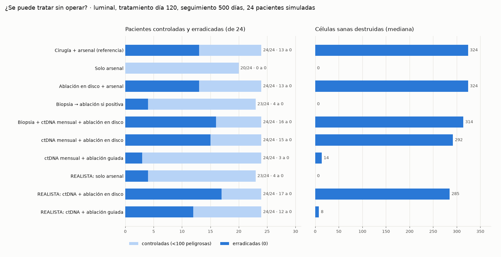
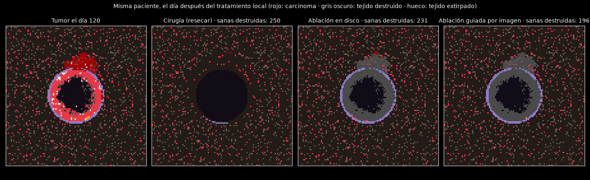

# 2026-11-05 · ¿Se puede tratar sin operar?

**Pregunta.** Hasta ahora, el mejor resultado del proyecto necesitaba extirpar el tumor
primero ([bitácora, 22-10](../BITACORA.md)). ¿Se puede llegar al mismo control **sin
bisturí** y con el menor daño posible al tejido sano, aprendiendo de lo que la clínica
ha publicado entre 2022 y 2026?

**Respuesta corta (en el modelo).** Sí. **ctDNA mensual + ablación guiada por imagen**
controla a las 24 pacientes simuladas, igual que la cirugía. Y **no necesita ver lo
invisible**: aunque la imagen solo detecte focos de ≥100 células, siguen controladas las
24, **22 no necesitan nunca que les toquen la mama** y la mediana de tejido sano
destruido es 0 (frente a 324 con la cirugía). El precio es que se cura menos del todo:
la mayoría conviven con restos de 2-11 células que mantiene a raya la inmunidad
(ver [Umbral de imagen](#umbral-de-imagen-la-prueba-de-realismo)).

## Lo que ha aprendido el mundo (las fuentes)

| Avance | Qué mostró | Fuente |
|---|---|---|
| Omitir la cirugía tras respuesta completa (MD Anderson) | 31 pacientes HER2+ o triple negativas sin operar tras biopsia por vacío negativa: **0 % de recaída en la mama** a ~5 años | [Kuerer, JAMA Oncol 2025](https://cancernetwork.com/view/omitting-breast-surgery-stalls-cancer-recurrence-in-exceptional-responders) |
| Crioablación (ensayo FIRST) | Ablación completa en el 89,6 % (96,9 % si ≤2 cm); **CDIS residual en el borde en el 12,5 %** | [FIRST, 2026](https://pmc.ncbi.nlm.nih.gov/articles/PMC13359561/) |
| Hormonoterapia + radioterapia ablativa | 53 % de respuestas completas en biopsia en luminales pequeños, sin operar | [ESTRO 2026](https://ascopost.com/news/may-2026/early-breast-cancer-is-surgery-omission-possible-following-estrogen-and-ablative-radiation-therapy/) |
| Biopsia por vacío como comprobación | RESPONDER: **17,8 % de falsos negativos**; en curso OPTIMIST (n=533) | [Revisión](https://www.ncbi.nlm.nih.gov/pmc/articles/PMC8724060/) · [OPTIMIST](https://clinicaltrials.gov/study/NCT05505357) |
| Vigilancia activa del CDIS de bajo riesgo | LORD: 6 % de invasivos con vigilancia frente a 9 % con cirugía (intermedio, ~2 años) | [EBCC 2026](https://ascopost.com/news/april-2026/early-results-from-a-trial-of-active-surveillance-for-low-risk-dcis-are-reassuring-say-researchers/) |
| ADN tumoral circulante (ctDNA) | Tras la neoadyuvancia no distingue bien quién tiene respuesta completa; aún no hay ensayos aleatorizados de desescalada | [ASCO Daily News](https://dailynews.ascopubs.org/do/personalized-treatment-de-escalation-early-stage-breast-cancer-using-ctdna) |

## Qué se añadió al simulador

| Función | Qué hace | Qué NO se le programa |
|---|---|---|
| `tejido.ablacionar()` | Destruye un volumen *in situ* (queda como necrosis, que atrae inmunidad). Borde con supervivientes configurable | El efecto «vacuna *in situ*»: sale del reclutamiento por inflamación que ya existía |
| `tejido.ablacionar(guiada=True)` | Solo apunta al **carcinoma visible**, un margen alrededor de cada foco | — |
| `tejido.biopsia()` | Cilindros de muestra del lecho tumoral; positiva si sale carcinoma | La tasa de falsos negativos: sale del muestreo |
| `tejido.ctdna()` | Fragmentos de ADN tumoral en una extracción (Poisson) | Solo un parámetro, calibrado contra la sensibilidad clínica antes de tratar |
| `tejido.focos_carcinoma()` | Focos = componentes conexas de carcinoma | — |

Scripts: [`sin_cirugia.py`](../../sin_cirugia.py) (los brazos) ·
[`prueba_residuo.py`](../../prueba_residuo.py) (biopsia frente a ctDNA) ·
[`capturas.py`](../../capturas.py) (imágenes). Salidas brutas en
[`resultados/2026-11-05/`](../../resultados/2026-11-05/).

## Resultados

Luminal, arsenal (troyano + guardiana de nicho + memoria) el día 120, seguimiento hasta
el día 500, 24 pacientes (semillas 1-24, emparejadas entre brazos).
*Controlada* = menos de 100 células peligrosas al final; *erradicada* = 0.

| Protocolo | Controladas | Erradicadas | Sanas destruidas (mediana) | Mama sin tocar |
|---|---|---|---|---|
| Cirugía + arsenal (referencia) | 24/24 | 13 | 324 | 0 |
| Solo arsenal | 20/24 | 0 | 0 | 24 |
| Ablación en disco + arsenal | 24/24 | 13 | 324 | 0 |
| Biopsia → ablación si positiva | 23/24 | 4 | 0 | 20 |
| Biopsia + ctDNA mensual → ablación en disco | 24/24 | 16 | 314 | 0 |
| ctDNA mensual → ablación en disco | 24/24 | 15 | 292 | 2 |
| ctDNA mensual → ablación guiada | 24/24 | 3 | 14 | 2 |
| **Tasa realista:** solo arsenal | 23/24 | 4 | 0 | 24 |
| **Tasa realista:** ctDNA → ablación en disco | 24/24 | **17** | 285 | 6 |
| **Tasa realista:** ctDNA → ablación guiada | **24/24** | 12 | **8** | 6 |

«Tasa realista» = tasa de mutación acelerada hasta el día del tratamiento (para que haya
tumor que tratar) y `CALIBRACIONES["realista"]` (2e-4) a partir de ahí, para que el
tejido no fabrique lesiones nuevas a ritmo de laboratorio.

### Hallazgos

1. **El bisturí no es lo que cura: lo es destruir el volumen.** La ablación con borde
   letal da exactamente lo mismo que la cirugía (24/24, 13 erradicadas) y destruye lo
   mismo (324 sanas).
2. **El borde superviviente de la ablación cuesta curaciones, no control** (13 → 7
   erradicadas con un 30 % del borde vivo). Coincide con el CDIS de borde de FIRST.
3. **La biopsia falla con restos pequeños, como en la clínica.** Foto del día 180
   ([salida](../../resultados/2026-11-05/00_prueba_residuo_dia180.txt)): 18 de 24
   pacientes conservan carcinoma, 11 de ellas de 1 a 4 células. Falsos negativos: 74 %
   con 6 cilindros, 66 % con 12, 28 % con 96.
4. **Una sola extracción de ctDNA tampoco basta** (37-69 % de falsos negativos según
   la calibración), igual que en la clínica. **Repetida cada mes sí:** ningún
   positivo falso y ninguna paciente se escapa.
5. **Parte de los positivos tardíos eran lesiones nuevas del campo, no recaídas.** Con
   la tasa realista, las pacientes que nunca dan positivo pasan de 2 a 6.
6. **Disyuntiva abierta: precisión frente a erradicación.** El disco arrasa también
   las células premutadas invisibles y cura más del todo (17 frente a 12). La guiada
   casi no daña, pero deja vivo el campo y algunas pacientes conviven con restos de
   1-22 células controlados por la inmunidad.

*Misma paciente con un tumor grande (~900 células alrededor de todo el conducto): aquí la
ablación guiada apenas ahorra tejido (196 frente a 250). Su ventaja aparece cuando se
actúa pronto sobre restos pequeños, que es lo que permite el ctDNA mensual.*

## Errores propios corregidos durante el estudio

- **Biopsia.** La primera versión daba positiva con cualquier célula con una mutación
  *driver*, incluidas las iniciadas, invisibles al microscopio. Inflaba los falsos
  negativos (42 %). Ahora solo cuenta el carcinoma. El primer brazo «Kuerer» de
  `01_sin_cirugia.txt` es anterior a la corrección; el válido es el de
  `02_puertas_biopsia_ctdna.txt`.
- **ctDNA.** Al principio solo contaba células con ≥2 drivers y dejaba fuera parte del
  carcinoma. Se igualó al criterio de la biopsia.
- **Resumen.** Se informó de 14 erradicaciones en «biopsia + ctDNA mensual»; recontando
  la salida bruta son 16.

## Limitaciones

- Conducto 2D de 1,65 mm de lado con el tiempo comprimido: las cifras son comparaciones
  entre brazos, no predicciones clínicas.
- **La ablación guiada supone que la imagen ve focos de muy pocas células.** Una
  resonancia real no ve por debajo de ~2 mm, y a esta escala el tumor entero mide menos
  de medio milímetro.
- La sensibilidad del ctDNA está calibrada, no medida, y el ensayo se idealiza (sin
  ruido de fondo ni hematopoyesis clonal).
- Los estudios clínicos que lo inspiran son series pequeñas (31 y 19 pacientes).

## Umbral de imagen: la prueba de realismo

La ablación guiada suponía que la imagen ve focos de 1 célula ([issue #1](https://github.com/TheIsmael12/breast-cancer-abm/issues/1)).
Aquí la imagen solo ve focos de **≥N células**. Si el ctDNA da positivo y no se ve
nada, se repite el arsenal sin tocar la mama, como ante una recaída molecular en la
clínica. Tasa realista tras tratar, las mismas 24 pacientes
([salida](../../resultados/2026-11-05/04_umbral_imagen.txt)).

| La imagen ve | Controladas | Erradicadas | Sanas destruidas (mediana) | Sin tocar la mama | ctDNA+ sin nada visible |
|---|---|---|---|---|---|
| todo (≥1) | 24/24 | 12 | 8 | 6 | 0 |
| ≥5 células | 24/24 | 5 | 0 | 18 | 12 |
| ≥25 células | 24/24 | 4 | 0 | 20 | 14 |
| **≥100 células** | **24/24** | 4 | **0** | **22** | 16 |
| nada (ciega) | 23/24 | 4 | 0 | 24 | 18 |

**Lectura.**

1. **El control no depende de ver focos diminutos.** De ≥5 a ≥100 células se siguen
   controlando las 24, y cuanto peor es la imagen, menos se toca.
2. **La ablación solo es necesaria para focos grandes y visibles.** El brazo ciego
   (23/24) no mejora al arsenal solo (también 23/24 con tasa realista): repetir el
   arsenal no añade nada medible. La paciente que falta (semilla 6, la del tumor de ~900
   células) se rescata en cuanto la imagen ve su foco y se ablaciona. Es la lógica
   clínica: lo visible se trata localmente; lo invisible se vigila y se trata por vía
   sistémica.
3. **Ver más cura más del todo, pero a costa de tejido.** Con imagen perfecta se
   erradica a 12; con imagen realista, a 4-5. Las demás quedan con restos de 2-11
   células que la memoria inmune contiene. Si ese «control» se sostiene a largo plazo
   (como la enfermedad mínima residual latente) o acaba recayendo, el modelo no lo puede
   decir: el seguimiento es de 380 días tras el tratamiento.

## Siguiente paso

**Llevarlo al 3D** (`sin_cirugia_3d.py`, criterio escrito en el propio script antes de
ejecutar). En 2D todo el tumor está cerca de la superficie; en 3D las terapias se quedan
en el borde ([capturas 05-06](../capturas/)). Si el protocolo aguanta en 3D, el
resultado gana mucho peso.

→ Hecho: [¿Aguanta en 3D el protocolo sin bisturí?](2026-11-06-sin-bisturi-en-3d.md) (sí: 8/8 frente a 4/8 del disco).
