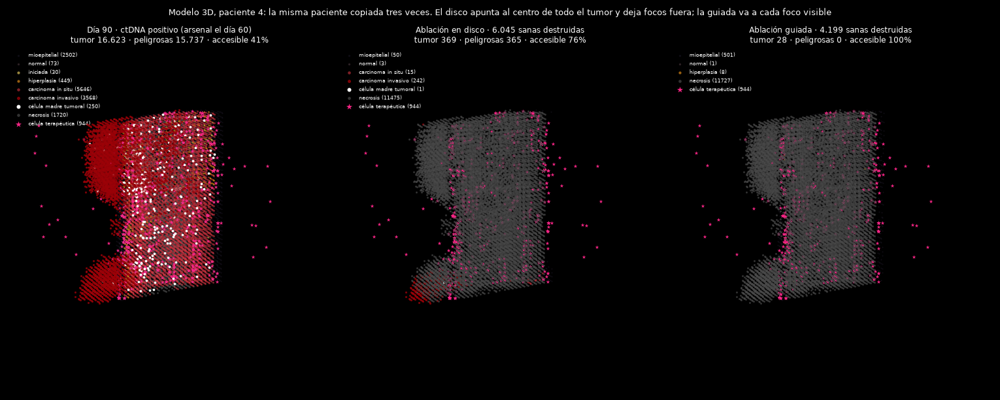

# 2026-11-06 · ¿Aguanta en 3D el protocolo sin bisturí?

**Pregunta.** En 2D, ctDNA mensual + ablación guiada controló a 24 de 24 pacientes
([avance anterior](2026-11-05-tratar-sin-operar.md)). Pero en 2D todo el tumor está cerca
de la superficie. En 3D las terapias se quedan en el borde de la masa
([capturas 05-06](../capturas/)). ¿Sobrevive el protocolo al paso a tres dimensiones?

**Respuesta corta (en el modelo).** Sí, y con más ventaja que en 2D. En el cilindro 3D,
**ctDNA mensual + ablación guiada controla a 8 de 8 pacientes** destruyendo una mediana
de **3.800 células sanas**. El equivalente a la cirugía (ablación en disco + arsenal)
controla a **4 de 8** y destruye **8.763**. Los fármacos solos no hacen nada en 3D.
Y **no hace falta ver focos pequeños**: con imagen que solo ve focos de ≥100 células
sigue controlando 8 de 8; lo que no se puede quitar es la ablación (imagen ciega: 0/8).

*Paciente 4 el día 90, copiada tres veces. El disco apunta al centroide de todo el tumor
y deja fuera un foco en la esquina (365 células peligrosas, que acaban llenando el
conducto: 100.900 el día 240). La guiada va a cada foco visible y lo deja en 0.*

## Diseño

Criterio escrito en [`sin_cirugia_3d.py`](../../sin_cirugia_3d.py) **antes de
ejecutar** (2026-11-05):

- Luminal, cilindro 3D de [`tejido3d.py`](../../tejido3d.py), 8 pacientes (semillas
  1-8, emparejadas entre brazos). Tratamiento el día 60 (en 3D el tumor crece mucho más
  deprisa que en 2D) y seguimiento hasta el día 240. Tasa de mutación realista (2e-4)
  desde el día 60.
- Arsenal: troyano + guardiana de nicho + memoria, dosis 300.
- ctDNA calibrado con estas mismas pacientes 3D a una sensibilidad del 75 % el día 60:
  2,25e-3 fragmentos por célula. Análisis cada 30 días desde el día 90.
- *Controlada* = menos del 5 % de la mediana sin tratar (4.855 células peligrosas).
- **El protocolo AGUANTA** si ctDNA + guiada controla al menos tantas pacientes como el
  disco + arsenal destruyendo menos de la mitad de tejido sano. **FALLA** si controla
  menos de la mitad.

## Resultados

[Salida bruta](../../resultados/2026-11-05/05_sin_cirugia_3d.txt). Células peligrosas
el día 240:

| Brazo | Mediana | Controladas | A 0 | Sanas destruidas (mediana) | Por paciente (1-8) |
|---|---|---|---|---|---|
| Nada | 97.102 | 0/8 | 0 | 0 | 11.221 · 97.370 · 97.089 · 97.861 · 10.774 · 97.115 · 96.955 · 97.629 |
| Solo arsenal | 96.756 | 0/8 | 0 | 0 | 11.013 · 97.465 · 96.598 · 97.732 · 10.928 · 96.845 · 96.667 · 97.616 |
| Ablación en disco + arsenal (≈ cirugía, día 60) | 5.204 | 4/8 | 0 | 8.763 | 18 · 78 · 10.096 · 100.900 · 33 · 10.671 · 313 · 100.275 |
| **ctDNA mensual → ablación guiada** | **32** | **8/8** | **2** | **3.800** | 67 · 0 · 24 · 0 · 604 · 39 · 51 · 5 |
| ctDNA mensual → ablación en disco | 99.834 | 1/8 | 0 | 5.980 | 21 · 100.433 · 32.585 · 103.301 · 6.398 · 102.371 · 99.236 · 100.817 |

En los dos brazos con ctDNA, las 8 pacientes dieron positivo en el primer análisis (día
90): ninguna se libró de la ablación.

**Veredicto según el criterio previo: AGUANTA.** La guiada controla más (8 frente a 4)
y destruye menos de la mitad de tejido sano (3.800 frente a 8.763).

### Hallazgos

1. **En 3D los fármacos solos son inútiles.** Con arsenal o sin él, el tumor llena el
   conducto igual (96.756 frente a 97.102). Es el muro de superficie de las capturas
   05-06, ahora medido sobre el desenlace: al final solo el 20-30 % del tumor es
   accesible.
2. **El disco falla cuando el tumor tiene varios focos.** Apunta al centroide de todas
   las células con *driver*. Si hay focos repartidos por el conducto, se le escapan, y
   ahí los fármacos no llegan. En las pacientes 4 y 8 el tumor vuelve a llenarlo todo,
   incluso por encima del brazo sin tratar, porque la ablación deja hueco para crecer.
3. **La ventaja de la guiada no viene de cuándo actúa.** La guiada actúa el día 90, 30
   días más tarde que el disco del día 60, y aun así gana. El brazo de control decisivo
   es el disco **el mismo día 90**: solo controla a 1 de 8. Con el tumor más grande y
   más repartido, una sola esfera ya no lo abarca. Lo que importa es apuntar a cada foco.
4. **En 3D la guiada daña más que en 2D, pero mucho menos que el disco.** En 2D la
   guiada destruía 8 células sanas de mediana. En 3D, 3.800, porque una bola de margen 2
   alrededor de cada célula de carcinoma en 26 vecinos abarca mucho tejido. Las
   «sanas» incluyen la capa mioepitelial y los fibroblastos, no solo epitelio luminal.
5. **Controlar no es curar.** Solo 2 de 8 llegan a 0. Las demás conviven con restos de
   5-604 células el día 240. La paciente 5 (604) es la que más se acerca al límite: si
   el control se midiera paciente a paciente frente a su propio brazo sin tratar
   (10.774), quedaría en el 5,6 %, justo por encima del umbral.

## Umbral de imagen en 3D

La guiada suponía que la imagen ve focos de 1 célula ([issue #1](https://github.com/TheIsmael12/breast-cancer-abm/issues/1)).
Aquí solo ve focos de **≥N células**. Si el ctDNA da positivo y no se ve nada, no se
ablaciona: solo se repite el arsenal, igual que en 2D. Mismas 8 pacientes; criterio
escrito en el script antes de ejecutar (`python sin_cirugia_3d.py --umbrales`,
[salida](../../resultados/2026-11-06/01_umbral_imagen_3d.txt)).

| La imagen ve | Controladas | A 0 | Sanas destruidas (mediana) | Peligrosas por paciente (1-8) |
|---|---|---|---|---|
| todo (≥1) | 8/8 | 2 | 3.800 | 67 · 0 · 24 · 0 · 604 · 39 · 51 · 5 |
| ≥5 células | 8/8 | 3 | 3.778 | 82 · 0 · 18 · 0 · 3.705 · 77 · 239 · 0 |
| ≥25 células | 8/8 | 3 | 3.774 | 82 · 0 · 18 · 0 · 320 · 74 · 239 · 0 |
| **≥100 células** | **8/8** | 3 | **3.774** | 82 · 0 · 18 · 0 · 320 · 74 · 239 · 0 |
| nada (ciega) | **0/8** | 0 | 0 | 92.975 · 97.322 · 91.163 · 97.691 · 10.694 · 96.873 · 96.386 · 97.541 |

**Veredicto según el criterio previo: el control NO depende de ver focos diminutos**
(≥100 controla 8/8; el mínimo era 7/8).

**Lectura.**

1. **En 3D, ver focos de ≥100 células basta.** El día 90 todos los focos en 3D son
   grandes: con ≥25 y con ≥100 la ablación es idéntica, célula a célula.
2. **Lo que no se puede quitar en 3D es la ablación.** Con la imagen ciega, el arsenal
   repetido no hace nada (96.630 de mediana frente a 97.102 sin tratar). Es lo
   **contrario que en 2D**, donde la ciega controlaba 23 de 24 porque los fármacos
   llegaban a todo el tumor. En 3D el tratamiento local que alcanza la masa es
   imprescindible; la imagen solo tiene que ser lo bastante buena para encontrarla.
3. **Dejar sin tocar los focos de menos de 5 células no empeora el resultado:** ver
   ≥5 erradica a 3 pacientes frente a 2 viéndolo todo y destruye lo mismo. La paciente
   5 sube a 3.705 con ≥5 y baja a 320 con ≥25: entre esos dos brazos solo cambian los
   focos de 5-24 células, así que la diferencia es azar de la simulación, no un efecto
   de la imagen. Con 8 pacientes no se puede separar mejor.

## Errores y contratiempos

- **El banco se cortó tres veces** por falta de memoria del ordenador (la primera,
  durante la noche; las otras dos, por otros proyectos abiertos a la vez). Se añadió
  una caché en disco (`resultados/cache_3d/`, fuera del repositorio): cada simulación
  terminada se guarda y el banco se retoma donde se quedó. El resultado no cambia, solo
  cómo se ejecuta.
- **El ctDNA calibrado cambió** entre la prueba corta del 5 de noviembre (3,89e-3, 2
  pacientes) y el banco completo (2,25e-3, 8 pacientes). Es lo esperado: se calibra con
  las pacientes de cada banco.

## Limitaciones

- **8 pacientes**, por debajo de las 12 que pide la [guía de contribución](../../CONTRIBUTING.md).
  Cada simulación 3D sin tratamiento tarda unos 15-20 minutos. Ampliar a 24 está
  pendiente.
- **Seguimiento de 180 días tras tratar.** Si los restos controlados se sostienen o
  acaban recayendo, el modelo aún no lo puede decir.
- **La imagen se modela como un umbral de tamaño de foco.** Ver focos de ≥100 células
  sigue siendo optimista frente a una resonancia real (~2 mm), porque a esta escala el
  conducto entero mide menos que eso. El umbral comprobado es relativo al modelo.
- **En 3D no hay reclutamiento inmune propio**: solo actúan las células terapéuticas
  (ver bitácora, 29-10). Parte del control que en 2D aportaba la inmunidad aquí no existe.
- Un solo cilindro de conducto y el tiempo comprimido ([issues #3 y #4](https://github.com/TheIsmael12/breast-cancer-abm/issues)).
  Las cifras comparan brazos; no son predicciones clínicas.

## Siguiente paso

- Ampliar a 24 pacientes cuando el ordenador tenga memoria libre (con 2-3 procesos).
